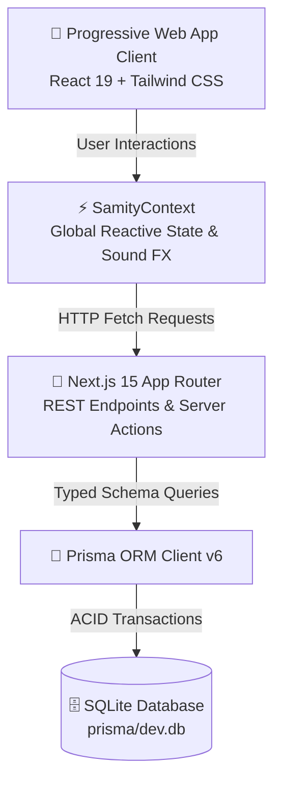
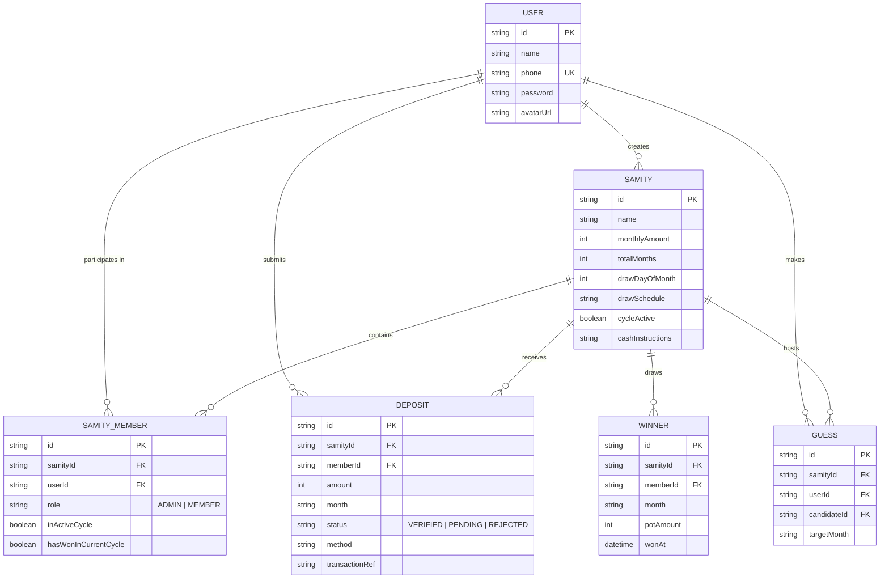

# 🎡 SamityWheel (SamityDraw)

<p align="center">
  
</p>

<p align="center">
  <strong>Next-Generation Micro-Savings (ROSCA / Samity) Platform with Provably Fair Lucky Wheel Draws & Transparent Financial Ledger</strong>
</p>

<p align="center">
  <a href="https://nextjs.org"></a>
  <a href="https://react.dev"></a>
  <a href="https://www.typescriptlang.org"></a>
  <a href="https://www.prisma.io"></a>
  <a href="https://tailwindcss.com"></a>
  <a href="LICENSE"></a>
</p>

---

## 📖 Executive Summary

**SamityWheel** is a modern, mobile-first Progressive Web Application (PWA) designed to digitize community savings committees (**Samity / ROSCA** — *Rotating Savings and Credit Associations*). 

Traditional informal samities suffer from manual cash handling disputes, opaque lottery draws, lost receipts, and administrative bottlenecks. **SamityWheel** solves this by combining:
- **Transparent Deposit Tracking**: Verified multi-channel payments (bKash, Nagad, Rocket, Bank Transfer, and Admin Cash Handover) paired with tamper-evident digital deposit vouchers.
- **Fair Wheel Draws**: An interactive HTML5 canvas wheel with dynamic slicing, physical deceleration, tick sound effects, and confetti celebrations.
- **Strict Cycle Integrity**: Ensures every participating member wins exactly **once** per active cycle before a reset can occur.
- **Role Symmetry**: Admins are full-fledged members who pay monthly deposits, participate in draws, and can seamlessly transfer leadership whenever needed.
- **Social Fun**: A community mini-game allowing members to guess the next winner 1 day after each round's draw, fostering trust and excitement.

---

## ✨ Key Features

### 1. 🔐 Robust Multi-Tenant Authentication & Session Management
- **Phone & Password Auth**: Built specifically for mobile-first financial experiences with real persistent sessions.
- **Quick Switcher**: Instant switching between Admin (`Rahim Ahmed`) and Members (`Nusrat Jahan`, `Tanvir Hasan`, etc.) for seamless auditing and testing.
- **Clean Light Mobile Theme**: Ergonomic fintech design following modern design token hierarchies (`bg-slate-50`, rounded-3xl cards, subtle border elevations).

### 2. 💳 Multi-Channel Deposits & Tamper-Evident Digital Vouchers
- **Supported Payment Gateways**: bKash, Nagad, Rocket, Bank Transfer, and In-Person Cash.
- **Dynamic Admin Handover**: Cash payment instructions automatically resolve the currently active Samity Admin's legal name and phone number in real-time.
- **Digital Deposit Slip**: Instant visual vouchers displaying transaction reference, timestamp, verified badge, and deposit month breakdown.

### 3. 🎡 Serial Dates & Admin-Only Lucky Wheel Draw
- **Serial Draw Day Configuration**: Admins configure the monthly draw day (e.g. 15th of every month) with a scheduled cycle calendar preview.
- **Admin-Gated Draws**: Only verified Admins can trigger the official draw that records the winner in the database (`HTTP 403` protected).
- **Interactive Member Reveal**: Members can press **"See Winner"** post-draw to witness a smooth canvas wheel spin that slows down and lands precisely on the winner's segment with sound and confetti.
- **Cycle Exclusion**: Members who have already won in the active cycle are automatically removed from future wheel slices until the cycle completes.

### 4. 🎯 "Guess the Next Winner!" Mini-Game
- **Smart Time-Lock**: Automatically activates **1 day after** a draw concludes.
- **Community Predictions**: Members choose who among the remaining candidates will win the next pot.
- **Live Voting Tallies**: Real-time percentage bars showing community consensus with a "Your Pick" indicator.
- **Simulator Mode**: Quick "Test Game Mode" toggle for development and demonstration purposes.

### 5. 🔄 Dynamic Admin Leadership Transfer
- **Atomic Transfer**: Transfers admin rights to any active member, updates the database creator record, and instantly updates payment handover instructions across the entire application.
- **Double-Confirmation Modal**: Safeguards against accidental leadership transfers.

### 6. 📱 Progressive Web App (PWA) Ready
- Fully configured [`manifest.json`](public/manifest.json) with fintech icons, standalone display mode, orientation locking, and service-worker cache readiness.

---

## 🏗️ System Architecture



### 📂 Directory Structure

```
SamityWheel/
├── .github/                     # GitHub workflows, issue & PR templates
│   ├── ISSUE_TEMPLATE/
│   │   ├── bug_report.md
│   │   └── feature_request.md
│   └── pull_request_template.md
├── brand/                       # Brand design guidelines, color tokens, and SVG assets
│   ├── logo.svg
│   └── icons/
├── prisma/                      # Database models, migrations, and seeds
│   ├── schema.prisma            # Core relational schema (User, Samity, Member, Deposit, Winner, Guess)
│   ├── seed.ts                  # Comprehensive demo seed script
│   └── dev.db                   # Local SQLite database
├── public/                      # Static assets, audio, and PWA manifest
│   ├── manifest.json            # PWA specification
│   ├── sounds/                  # Tick sound and fanfare audio
│   └── icons/
├── src/
│   ├── app/                     # Next.js 15 App Router
│   │   ├── api/                 # Secure REST API route handlers
│   │   │   ├── auth/            # Sign in, sign up, session verification
│   │   │   └── samity/          # Samity, deposit verification, wheel draw, cycle, guess
│   │   ├── layout.tsx           # Global root layout with metadata & fonts
│   │   └── page.tsx             # Main dashboard controller with bottom tab navigation
│   ├── components/              # Modular UI components
│   │   ├── admin/               # Admin controls: verification, members, cycle & transfer
│   │   ├── common/              # Navbar, QuickSwitcher, Toast, Confetti
│   │   ├── dashboard/           # Summary cards, cycle stats & activity log
│   │   ├── deposit/             # Pay deposit form & digital voucher generator
│   │   ├── wheel/               # HTML5 Wheel, Member reveal & Guessing game
│   │   └── winners/             # Historical winners roster & pot payout receipts
│   ├── context/                 # SamityContext state container
│   ├── lib/                     # Prisma client singleton, audio utils & date formatters
│   └── types/                   # TypeScript domain definitions
├── CONTRIBUTING.md              # Open source contribution guidelines
├── CODE_OF_CONDUCT.md           # Community code of conduct
├── SECURITY.md                  # Security and vulnerability disclosure policies
├── CHANGELOG.md                 # Semantic versioning release log
└── LICENSE                      # MIT Open Source License
```

---

## 🗄️ Data Model & Relational Schema



---

## 🚀 Quick Start Guide

### Prerequisites
- **Node.js**: v18.18.0 or later (v20+ recommended)
- **npm**: v9+ (or `pnpm` / `yarn`)
- **Git**

### Installation

1. **Clone the repository:**
   ```bash
   git clone https://github.com/your-username/SamityWheel.git
   cd SamityWheel
   ```

2. **Install project dependencies:**
   ```bash
   npm install
   ```

3. **Configure Environment Variables:**
   ```bash
   cp .env.example .env
   ```

4. **Initialize and Seed the Database:**
   ```bash
   # Push schema to SQLite
   npx prisma db push

   # Seed default users, samity, verified deposits, and historical winners
   npx tsx prisma/seed.ts
   ```

5. **Start the Development Server:**
   ```bash
   npm run dev
   ```

6. **Open in Browser:**
   Navigate to [http://localhost:3000](http://localhost:3000).

---

## 👥 Pre-Configured Test Accounts

The included seed database comes pre-populated with realistic test accounts. Use the **Quick Switcher** in the top navigation bar or log in manually with the following credentials:

| Name | Role | Phone Number | Password | Notes |
|---|---|---|---|---|
| **Rahim Ahmed** | 👑 Admin / Member | `01711-000001` | `password123` | Full admin privileges + eligible member |
| **Nusrat Jahan** | 👤 Member | `01812-000002` | `password123` | Active member (Past winner) |
| **Tanvir Hasan** | 👤 Member | `01913-000003` | `password123` | Eligible wheel candidate |
| **Fatima Begum** | 👤 Member | `01614-000004` | `password123` | Eligible wheel candidate |
| **Kamrul Islam** | 👤 Member | `01515-000005` | `password123` | Eligible wheel candidate |

---

## 📡 Core API Reference

| Endpoint | Method | Role | Description |
|---|---|---|---|
| `/api/auth/login` | `POST` | Public | Authenticates user via phone & password |
| `/api/auth/register` | `POST` | Public | Registers a new user account |
| `/api/samity/[id]` | `GET` | Authenticated | Retrieves samity details, members, deposits & winners |
| `/api/samity/[id]/deposit` | `POST` | Member/Admin | Submits deposit payment with transaction proof |
| `/api/samity/[id]/verify-deposit` | `POST` | Admin Only | Approves or rejects a pending deposit submission |
| `/api/samity/[id]/draw-winner` | `POST` | Admin Only | Executes official wheel draw and commits round winner |
| `/api/samity/[id]/cycle` | `POST` | Admin Only | Configures participating cycle members & serial draw dates |
| `/api/samity/[id]/guess` | `POST` | Member/Admin | Submits or updates prediction for next winner mini-game |
| `/api/samity/[id]/transfer-admin` | `POST` | Admin Only | Transfers admin ownership atomically to another member |

---

## 🧪 Testing & Validation

```bash
# Run Next.js linting
npm run lint

# Validate TypeScript type compilation
npx tsc --noEmit

# Inspect database contents with Prisma Studio
npx prisma studio
```

---

## 🛡️ Security & Financial Integrity

1. **Provable Audit Trail**: Every deposit requires a transaction reference and is timestamped with verified administrative audit logs.
2. **Immutable Cycle History**: A winner cannot win a second time within the active cycle, enforced both by backend constraints and client-side wheel exclusion.
3. **Atomic Leadership Transfer**: Database transactions ensure leadership transitions cannot result in orphaned or multi-admin states.
4. **Input Sanitization**: All incoming payload fields are validated against strict TypeScript types and Prisma constraints.

---

## 🤝 Contributing

We welcome contributions from the community! Please read our [CONTRIBUTING.md](CONTRIBUTING.md) guide and [CODE_OF_CONDUCT.md](CODE_OF_CONDUCT.md) before submitting pull requests.

---

## 📄 License

This project is open-source and distributed under the terms of the [MIT License](LICENSE).
